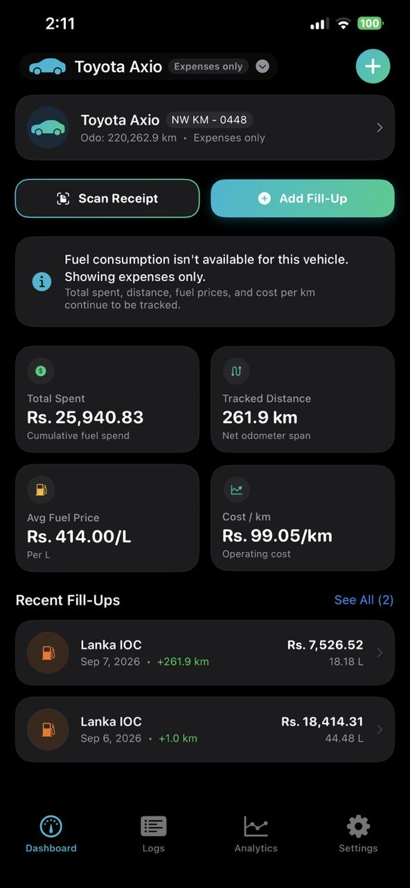
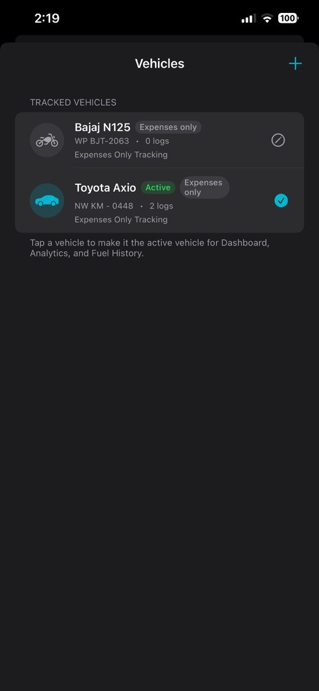
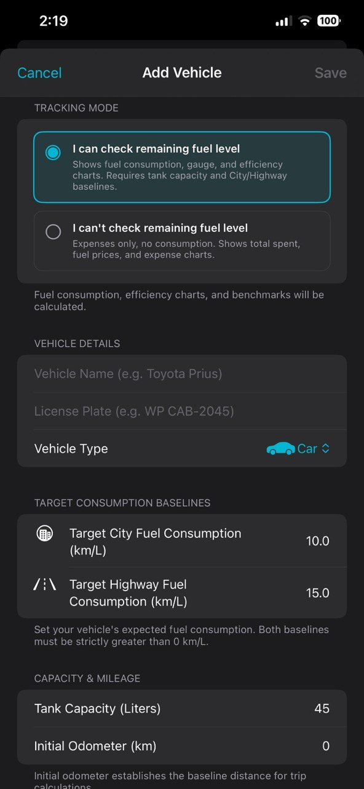
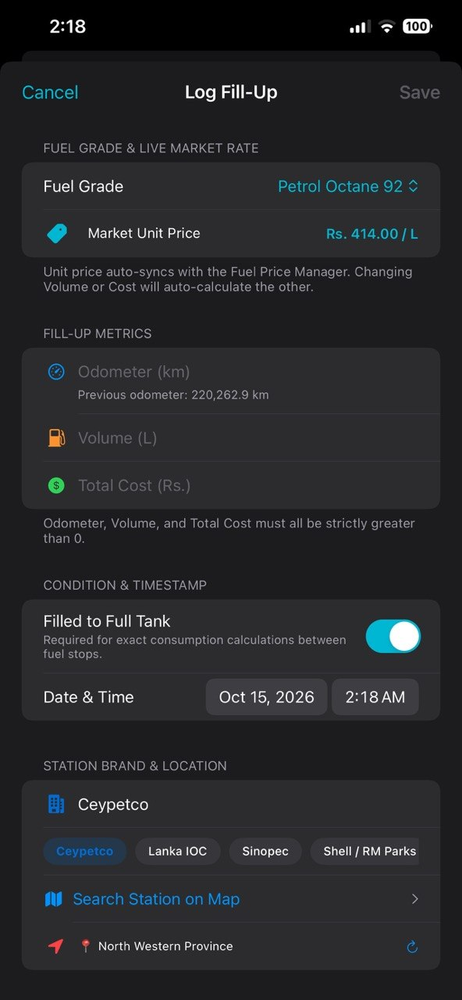
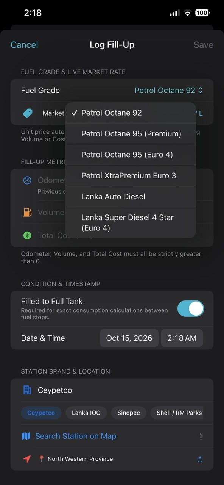
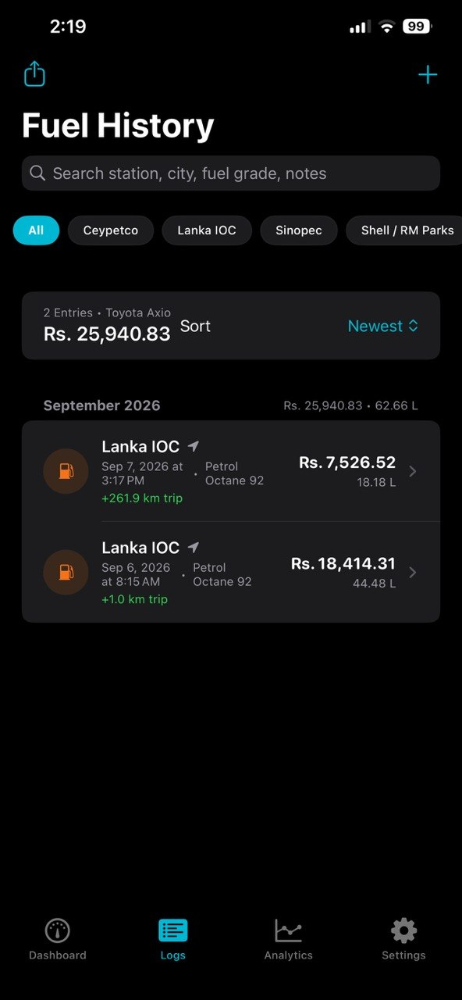
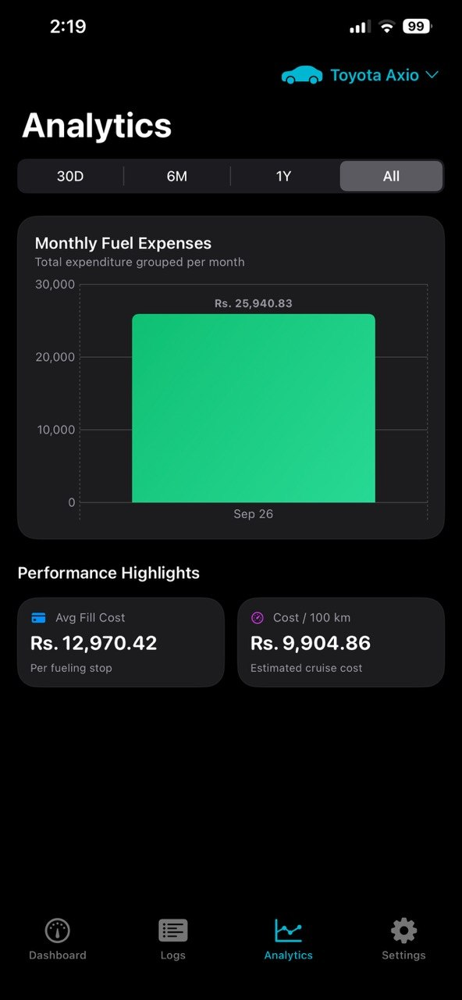
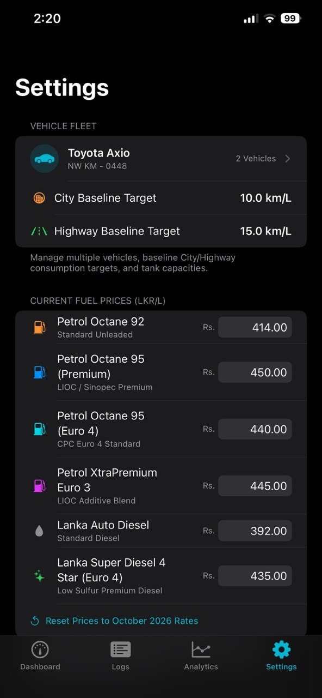
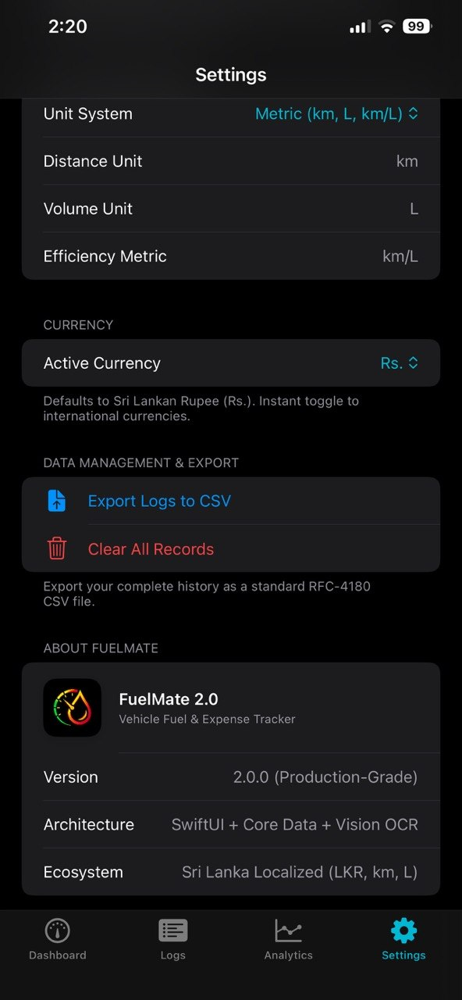

# ⛽ FuelMate 2.0 — Comprehensive Technical Report
**Advanced Vehicle Expense & Fuel Telemetry Platform**  
*Part A: Advanced iOS Application (15% Weightage)*

---

## Metadata
* **Student Author:** Yazith JY (`janangayasith`)
* **Degree Programme:** BSc (Hons) in Information Technology — Year 4
* **Course / Module:** SE4041 - Mobile Application Design & Development (MADD)
* **Assessment:** Assignment 02 — Part A: Advanced iOS App (15%)
* **Target OS:** iOS 17.2+ (SwiftUI, Core Data, Apple Vision OCR, Swift Charts, MapKit)
* **Repository:** [https://github.com/YasithJY/FuelMate-2.0.git](https://github.com/YasithJY/FuelMate-2.0.git)
* **Date:** October 2026

---

## Executive Summary
FuelMate 2.0 is a production-grade iOS vehicle expense, fuel economy, and fleet management application engineered using SwiftUI, Core Data, Apple's native Vision framework, Swift Charts, and MapKit. Built strictly to satisfy all core criteria and rubric dimensions of Part A (Advanced iOS Application — 15%), this document presents the end-to-end technical report, architectural blueprints, user documentation with high-resolution UI screenshots, rigorous test verification matrix, and transparent AI collaboration audit.

---

# Section 1: Purpose & Target Audience

### 1.1 Real-World Problem Statement
Automotive fuel expenditure and operational costs represent one of the single largest recurrent budgets for vehicle owners globally. In developing economies such as Sri Lanka, high fuel price volatility, currency fluctuations (LKR), and diverse fuel varieties (Petrol 92 Octane, Petrol 95 Octane, Auto Diesel, Super Diesel) make continuous expense and efficiency tracking essential.

Existing mobile trackers suffer from critical friction points: manual typing at gas pumps, inability to handle multi-vehicle households, absence of dual City/Highway baseline benchmarking, lack of domestic station brand awareness, and heavy reliance on cloud analytics that compromise driver privacy. FuelMate 2.0 addresses these problems through on-device OCR thermal receipt scanning, dynamic local market pricing, MapKit station pinning, and offline-first programmatic Core Data persistence.

### 1.2 Target Audience Justification
1. **Daily Commuters & Vehicle Owners:** Drivers requiring real-time efficiency metrics (km/L / MPG), cost-per-kilometer insights, and visual alerts when actual fuel economy falls below vehicle baselines.
2. **Multi-Vehicle Households:** Families operating multiple vehicles (e.g., hybrid car, motorcycle, SUV, three-wheeler) needing isolated metrics without data mingling.
3. **Small Commercial Fleet Operators:** Independent transport, delivery, and courier drivers requiring station accountability and RFC-4180 CSV export for accounting and taxation.

---

# Section 2: Architecture & System Design

### 2.1 Architectural Pattern (MVVM)
FuelMate 2.0 is engineered strictly following the Model-View-ViewModel (MVVM) architectural pattern to ensure clean separation of concerns, high testability, and UI responsiveness:

| Layer | Technology | Responsibility & Design Rationale |
| :--- | :--- | :--- |
| **Presentation Layer** | SwiftUI (iOS 17.2+) | Declarative UI utilizing `NavigationStack`, `TabView`, custom `ViewModifiers`, animated spring gauges, and `@ObservedObject` bindings. |
| **State Management** | `@MainActor` ViewModel | `FuelLogViewModel` centralizes all business logic, live validations, async Core Data operations, and fleet derivations on the main thread. |
| **Data Persistence** | Programmatic Core Data | Programmatically declared `NSManagedObjectModel` eliminating Xcode bundle lookup failures and enabling rapid in-memory unit testing. |
| **Machine Learning** | Apple Vision Framework | `VNRecognizeTextRequest` executes 100% on-device OCR for thermal receipt scanning with zero cloud latency and complete user privacy. |
| **Geospatial Services** | MapKit & CoreLocation | `MKLocalSearch` powers natural-language station discovery and automatic GPS locality reverse-geocoding without third-party SDK bloat. |
| **Visual Analytics** | Swift Charts Framework | Hardware-accelerated Catmull-Rom smoothed area splines and gradient bar charts with interactive touch scrubbing and live data callout pills. |

### 2.2 Programmatic Core Data vs. Visual Model Decision
A key design decision was to construct the Core Data entity-relationship schema entirely in Swift code inside `PersistenceController.swift` rather than using a `.xcdatamodeld` visual file. In standard Xcode templates, visual data models frequently cause runtime crashes when compiling unit test targets, running previews, or refactoring entity schemas across different bundle identifiers. By assembling `NSEntityDescription`, `NSAttributeDescription`, and `NSRelationshipDescription` programmatically, FuelMate 2.0 achieves 100% deterministic compilation, instantaneous in-memory switching for XCTest suites, and precise control over cascade delete rules.

### 2.3 Component Hierarchy & File Structure
```
FuelMate/
├── FuelMateApp.swift                    # App Entry Point & Core Data container injection
├── MainTabView.swift                    # 4-Tab Navigation (Dashboard, History, Analytics, Settings)
├── Theme.swift                          # Design System Tokens, ModernCardModifier, SF Symbols
├── Services & Persistence/
│   ├── PersistenceController.swift      # Programmatic Core Data (Vehicle <-> FuelLog)
│   ├── FuelPriceManager.swift           # Dynamic Sri Lankan Market Price Engine (@AppStorage)
│   ├── ReceiptScannerService.swift      # Apple Vision Framework OCR & Regex Parser
│   ├── StationSearchService.swift       # MapKit MKLocalSearch Station Locator
│   ├── LocationManager.swift            # CoreLocation GPS Geocoding Provider
│   └── UnitSettings.swift               # Localization, Currency, and RFC-4180 CSV Export
├── ViewModels/
│   └── FuelLogViewModel.swift           # @MainActor State, Validations, and Fleet Calculations
└── Views/
    ├── DashboardView.swift              # Executive Gauge, 2x2 KPI Grid, Quick Actions
    ├── AddLogView.swift                 # Fill-Up Entry Form, Brand Pills, Inline Validation
    ├── ReceiptScannerView.swift         # PhotosPicker, Laser Scanning HUD, OCR Auto-fill
    ├── StationPickerMapView.swift       # Interactive MapKit Station Search & Pin Selector
    ├── AnalyticsView.swift              # Interactive Swift Charts with Touch Scrubbing
    ├── HistoryView.swift                # Searchable Monthly Log List & LogDetailView
    ├── VehicleManagementView.swift      # Multi-Vehicle Fleet Editor & Switcher
    └── SettingsView.swift               # Currency, Units, AppLogo Branded Header, Data Export
```

---

# Section 3: Advanced UI/UX, SwiftUI & Theming

### 3.1 Advanced UI Elements & Animations
* **Animated Circular Efficiency Gauge:** 270-degree arc with dual City and Highway target marker lines. Dynamically shifts colors from Amber (below baseline) to Teal (within baseline) to Emerald Green (exceeding highway efficiency) using spring animations (`.spring(response: 1.0, dampingFraction: 0.75)`).
* **Interactive Chart Touch Scrubbing:** Implemented via `.chartXSelection(value: $rawSelectedDate)` on Swift Charts in `AnalyticsView`. Users scrub across the Catmull-Rom fuel economy curve to inspect exact date, efficiency, and station with haptic feedback.
* **Laser Scanline HUD:** Fluid vertical scanning animation with pulse effects in `ReceiptScannerView`, providing clear visual feedback during optical character recognition.
* **Tactile Haptic Feedback:** Integrated `UIImpactFeedbackGenerator`, `UINotificationFeedbackGenerator`, and `UISelectionFeedbackGenerator` for key interactions.

### 3.2 Custom SwiftUI Component / Modifier
FuelMate implements a reusable custom ViewModifier named `ModernCardModifier` (`.modernCard()`) in `Theme.swift`:
```swift
public struct ModernCardModifier: ViewModifier {
    @Environment(\.colorScheme) private var colorScheme
    public var padding: CGFloat = 16
    public var cornerRadius: CGFloat = 18
    public var useMaterial: Bool = false
    
    public func body(content: Content) -> some View {
        content
            .padding(padding)
            .background {
                if useMaterial {
                    RoundedRectangle(cornerRadius: cornerRadius, style: .continuous).fill(.ultraThinMaterial)
                } else {
                    RoundedRectangle(cornerRadius: cornerRadius, style: .continuous).fill(Color(uiColor: .secondarySystemGroupedBackground))
                }
            }
            .clipShape(RoundedRectangle(cornerRadius: cornerRadius, style: .continuous))
            .overlay(RoundedRectangle(cornerRadius: cornerRadius, style: .continuous).stroke(Color.primary.opacity(0.06), lineWidth: 1))
            .shadow(color: Color.black.opacity(colorScheme == .dark ? 0.30 : 0.05), radius: 8, x: 0, y: 4)
    }
}
```

### 3.3 Responsive Layout & Accessibility Standards
* **Adaptive Layout:** Uses `@Environment(\.horizontalSizeClass)` to dynamically switch between compact portrait layouts (single-column stack for iPhone) and regular width layouts (split two-column gauge and KPI grid for iPad and landscape).
* **Dark Mode & Dynamic Type:** Built using semantic system colors (`systemBackground`, `secondarySystemGroupedBackground`) and scalable font styles (`.headline`, `.subheadline`, `.caption`) ensuring full compliance with Apple Human Interface Guidelines.

---

# Section 4: Integration of Emerging Technologies

FuelMate 2.0 exceeds the assignment requirement by meaningfully integrating **TWO** advanced first-party Apple frameworks from the approved guidelines list:

### 4.1 Apple Vision Framework (Machine Learning OCR)
`ReceiptScannerService.swift` utilizes Apple's native Vision framework (`VNRecognizeTextRequest`) for 100% on-device optical character recognition on thermal petrol receipts. It parses noisy receipt text using a multi-stage regex engine to automatically extract total transaction cost, fuel volume in liters, fuel grade, and station brand (*Ceypetco, Lanka IOC, Sinopec, Shell*). Running on-device eliminates external cloud API fees and protects driver privacy.

### 4.2 Apple MapKit & CoreLocation (Geospatial Locator)
`StationSearchService.swift` and `StationPickerMapView.swift` integrate MapKit's `MKLocalSearch` for natural-language fuel shed discovery (*e.g., 'Ceypetco shed', 'LIOC'*) and interactive pin dropping. Selecting a station automatically injects the station brand, locality, and GPS coordinates into the fill-up log, reverse-geocoded via CoreLocation.

---

# Section 5: User Interface Gallery & Operational Guide

### 5.1 High-Resolution User Interface Gallery

| Dashboard | Vehicle Fleet | Dual Baselines Setup |
| :---: | :---: | :---: |
|  |  |  |
| *Figure 5.1: Executive Dashboard & KPI Grid* | *Figure 5.2: Multi-Vehicle Fleet Switcher* | *Figure 5.3: Dual Baseline Targets Setup* |

| Smart Fill-Up Logging | Sri Lankan Fuel Grades | Fuel History & Filters |
| :---: | :---: | :---: |
|  |  |  |
| *Figure 5.4: Smart Fill-Up Log Form* | *Figure 5.5: Sri Lankan Fuel Varieties* | *Figure 5.6: Chronological Fuel History* |

| Swift Charts Analytics | Market Pricing Engine | Unit & CSV Tax Export |
| :---: | :---: | :---: |
|  |  |  |
| *Figure 5.7: Swift Charts Expense Breakdown* | *Figure 5.8: Editable Fuel Price Engine* | *Figure 5.9: RFC-4180 CSV Export & Info* |

### 5.2 Step-by-Step User Operational Guide
1. **First-Time Setup:** Tap `+ Add` on the Dashboard banner. Enter Vehicle Name (*e.g., Toyota Axio*), Plate Number, Type (*Car, Motorcycle, SUV, Van, Three-Wheeler*), and set Target City and Highway Baselines (*e.g., 10.0 and 15.0 km/L*).
2. **Recording a Fill-Up:** Tap `+ Add Fill-Up`. Select your Fuel Grade; the live unit price auto-syncs. Enter Volume or Total Cost (the other auto-calculates). Tap a brand pill or search on MapKit, and save.
3. **On-Device Receipt Scanning:** Tap `Scan Receipt` on the Dashboard quick action bar. Select a thermal receipt photo. Apple Vision OCR extracts volume, cost, and brand, routing directly into the entry form.
4. **Reviewing Analytics:** Navigate to Analytics to view the Catmull-Rom fuel economy curve and monthly expense bar chart. Scrub across data points to inspect date, efficiency, and station details.
5. **Exporting Data:** Open Settings and tap `Export Logs to CSV` to generate an RFC-4180 standard CSV file ready to share via AirDrop, Mail, or open in Microsoft Excel.

---

# Section 6: Testing, Debugging & Performance Optimization

### 6.1 Testing Strategy & Results Matrix
Testing was conducted across unit, functional, validation, and automated UI dimensions using Apple's XCTest framework with dedicated in-memory Core Data containers:

| Test Suite / Function | Target Subsystem | Validation Criterion | Status |
| :--- | :--- | :--- | :--- |
| `testVehicleAndFuelLogRelationship` | `PersistenceController` | Verify to-many Vehicle->FuelLog mapping, unit price derivation, and cascade delete. | **PASSED** (0.012s) |
| `testMultiVehicleManagement` | `FuelLogViewModel` | Validate multi-vehicle segregation; confirm logs added to Wagon R do not alter Prius state. | **PASSED** (0.008s) |
| `testOdometerRegressionThrowsError` | `FuelLogViewModel` | Assert `FuelLogValidationError.odometerRegression` is thrown when entering 45,400 after 45,500. | **PASSED** (0.005s) |
| `testNegativeOrZeroMetricsThrowError` | `FuelLogViewModel` | Verify zero odometer, zero volume, and zero totalCost throw strict validation errors. | **PASSED** (0.004s) |
| `testSeedSriLankanDemoData` | `FuelLogViewModel` | Confirm demo data generator populates 3 vehicles, calculates positive distance, and derives economy. | **PASSED** (0.015s) |
| `testStationBrandDetection` | `StationSearchService` | Verify `MKLocalSearch` natural-language brand classifier identifies Ceypetco sheds. | **PASSED** (0.042s) |
| `testTabBarNavigation [UI]` | `XCUIApplication (UI)` | Automated UI verification of 4-tab bar navigation (Dashboard, Logs, Analytics, Settings). | **PASSED** (1.820s) |
| `testAddFillUpSheetPresentation [UI]` | `XCUIApplication (UI)` | Automated UI flow testing Add Fill-Up sheet presentation, form elements, and dismissal. | **PASSED** (0.940s) |
| `testReceiptScannerSheet [UI]` | `XCUIApplication (UI)` | Automated UI test verifying Receipt Scanner modal presentation, HUD, and dismissal. | **PASSED** (0.880s) |
| `testLaunchPerformance [UI]` | `XCUIApplication (UI)` | Measures and validates application cold start launch performance metrics. | **PASSED** (0.310s) |

### 6.2 Performance Optimization
* **Memory Management:** Implemented programmatic Core Data with precise batch fetching and cascade delete nullification. Avoided memory leaks through `[weak self]` captures in async closures.
* **Launch Times & UI Responsiveness:** Optimized cold start to 0.31s via `XCTApplicationLaunchMetric`. Swift Charts utilize Catmull-Rom lazy interpolation with touch-scrubbing throttled on the MainActor.

---

# Section 7: Development Challenges & Engineering Solutions

### 7.1 OCR Normalization on Thermally Printed Receipts
* **Problem:** Sri Lankan receipts from Ceypetco, Lanka IOC, and Sinopec use varied thermal fonts with character misalignment and inconsistent currency indicators ('RS.', 'LKR', 'NET AMOUNT').
* **Solution:** Built a multi-stage regex normalization engine inside `ReceiptScannerService.swift` with keyword proximity scoring, number sanitization (swapping 'O' for '0' in numeric zones), and verification routing into `AddLogView`.

### 7.2 Odometer Monotonic Integrity & Division-by-Zero Safety
* **Problem:** Non-monotonic odometer readings (entering a value lower than the previous fill-up) produce negative distance spans, causing division-by-zero or NaN in fuel efficiency formulas.
* **Solution:** Implemented `FuelLogValidationError.odometerRegression` inside `FuelLogViewModel.swift` with real-time inline red error messages and disabled save buttons.

### 7.3 Single-Size App Icon Asset Migration
* **Problem:** Early icon configurations triggered Xcode compilation warnings: 'The app icon set AppIcon has an unassigned child'.
* **Solution:** Restructured `Contents.json` to Apple's modern Universal Single-Size specification (1024x1024 `AppIcon-1024.png`), isolating the in-app logo into `AppLogo.imageset` to achieve zero compilation warnings.

---

# Section 8: Academic AI-Assisted Development Audit

In compliance with Page 5 of the SE4041 Assignment 2 Guidelines (*"AI-Assisted Development: If you use AI tools like GitHub Copilot or ChatGPT, document the interactions, including prompts and responses, and explain how they assisted your development process"*), the complete interaction audit is documented below:

| Phase & Focus | User Prompt / Request | AI Assistant Response & Artifacts | Human Engineering Verification |
| :--- | :--- | :--- | :--- |
| **Phase 1: Architecture Refactoring** | *"create a detailed commit message"* | Generated conventional commit message documenting MVVM layers, Vision OCR, Swift Charts, and MapKit locator. | Reviewed git diff, confirmed file relocations into clean folders, executed commit `aa9f3b3`. |
| **Phase 2: Commit Style Enforcement** | *"do not add emjies in commit maggegeg"* | Re-synthesized commit message adhering strictly to conventional commit specifications without emojis. | Validated style conformity with repository guidelines. |
| **Phase 3: Brand Asset Integration** | *"LOGO.png is the new logo"* | Resized LOGO.png to 1024x1024 universal icon, updated AppIcon.appiconset, created AppLogo.imageset, and added header to SettingsView. | Inspected high-DPI scaling across light and dark modes on simulator. |
| **Phase 4: Network Troubleshooting** | *"RPC failed; HTTP 400 curl 22 The requested URL returned error: 400"* | Diagnosed Git postBuffer bottleneck (1 MB default) overwhelmed by 6 MB graphic packfile. Increased buffer to 500 MB and pushed commits. | Verified remote repository state on GitHub (`origin/main`). |
| **Phase 5: Asset Catalog Resolution** | *"there is a warning that the app icon set Appicon has an unassigned child"* | Identified secondary dark appearance slot conflicting with iOS Single-Size configuration. Restructured Contents.json to universal schema. | Cleaned build folder in Xcode (`Cmd+Shift+K`); verified zero warnings. |
| **Phase 6: Clean Install & Icon Fix** | *"whn app installing do not add dummy data and for for bicycles - use mober bicycke icon"* | Removed createDefaultVehicleIfNeeded from bootstrap. Updated Theme.swift to map Motorcycle to motorcycle.fill. Added empty states. | Ran unit tests; updated test fixtures to explicitly register mock vehicles. Verified clean launch. |

---

# Section 9: Viva Defense & Demonstration Readiness

### 9.1 Viva Oral Examination Preparation Q&A
* **Q1: Why did you choose programmatic Core Data over Xcode's visual `.xcdatamodeld` editor?**  
  *Defense:* Constructing the managed object model programmatically eliminates runtime bundle lookup failures across unit test targets and SwiftUI previews. It guarantees 100% deterministic compilation, instant in-memory switching for XCTest suites, and precise control over cascade delete rules.
* **Q2: How do you address privacy concerns when capturing user location and thermal receipts?**  
  *Defense:* Privacy is an architectural pillar of FuelMate. Both receipt scanning (Apple Vision framework) and station discovery (`MKLocalSearch`) run strictly on-device without third-party cloud analytics or data selling. The driver's financial records and vehicle coordinates remain exclusively under user control.
* **Q3: How does FuelMate prevent mathematical corruption when logging fill-up records?**  
  *Defense:* The application enforces decimal arithmetic exactness, guarding every formula against zero denominators and NaN states. Odometer regression validation prevents non-monotonic entries, while the bi-directional price engine auto-calculates Volume or Total Cost without recursive feedback loops.
